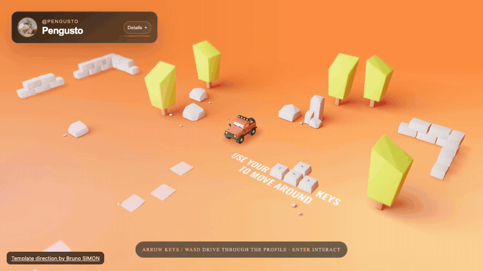

<picture>
<source media="(prefers-color-scheme: dark) and (max-width: 600px)" srcset="assets/profile-banner-purple-mobile.png">
<source media="(prefers-color-scheme: light) and (max-width: 600px)" srcset="assets/profile-banner-purple-light-mobile.png">
<source media="(prefers-color-scheme: dark)" srcset="assets/profile-banner-purple.png">

</picture>

<picture>
<source media="(prefers-color-scheme: dark) and (max-width: 600px)" srcset="assets/scan-mobile.svg?v=iris-20261024">
<source media="(prefers-color-scheme: light) and (max-width: 600px)" srcset="assets/scan-light-mobile.svg?v=iris-20261024">
<source media="(prefers-color-scheme: dark)" srcset="assets/scan.svg?v=iris-20261024">

</picture>

<picture>
<source media="(prefers-color-scheme: dark) and (max-width: 600px)" srcset="assets/intro-mobile.svg?v=iris-20261024">
<source media="(prefers-color-scheme: light) and (max-width: 600px)" srcset="assets/intro-light-mobile.svg?v=iris-20261024">
<source media="(prefers-color-scheme: dark)" srcset="assets/intro.svg?v=iris-20261024">

</picture>

<a href="https://github.com/pengusto"><picture><source media="(prefers-color-scheme: dark)" srcset="assets/link-01.svg?v=iris-20261024"></picture></a>

## The city I’m building

<picture>
<source media="(prefers-color-scheme: dark) and (max-width: 600px)" srcset="assets/city-mobile.svg?v=lastyear-20261024">
<source media="(prefers-color-scheme: light) and (max-width: 600px)" srcset="assets/city-light-mobile.svg?v=lastyear-20261024">
<source media="(prefers-color-scheme: dark)" srcset="assets/city.svg?v=lastyear-20261024">

</picture>

## Drive through my work

<a href="https://pengusto.github.io/worldfolio/">
<picture>
<source media="(prefers-reduced-motion: reduce)" srcset="assets/worldfolio-poster.png">

</picture>
</a>

[Explore Worldfolio ↗](https://pengusto.github.io/worldfolio/) · Arrow keys / WASD to drive, Enter to interact. Portfolio direction by [Bruno SIMON](https://github.com/brunosimon/folio-2019), adapted through GitSkins. Project data is a saved public-profile snapshot.

## Selected work

**Kaplum Studio** · Learn JavaScript by drawing. [Try the lesson ↗](https://pengusto.github.io/kaplum-studio/#course/square)

### Landmarks

<a href="https://github.com/pengusto/kaplum-studio"><picture><source media="(prefers-color-scheme: dark)" srcset="assets/project-kaplum-studio.svg?v=compact-20261024"></picture></a>
<a href="https://github.com/pengusto/push-my-tabs"><picture><source media="(prefers-color-scheme: dark)" srcset="assets/project-push-my-tabs.svg?v=compact-20261024"></picture></a>
<a href="https://github.com/pengusto/let-him-grill"><picture><source media="(prefers-color-scheme: dark)" srcset="assets/project-let-him-grill.svg?v=compact-20261024"></picture></a>
<a href="https://github.com/pengusto/penguin-patches"><picture><source media="(prefers-color-scheme: dark)" srcset="assets/project-penguin-patches.svg?v=compact-20261024"></picture></a>

## Upstream

<a href="https://github.com/lidge-jun/opencodex/pull/6388"><picture><source media="(prefers-color-scheme: dark)" srcset="assets/upstream-opencodex.svg?v=compact-20261024"></picture></a>
<a href="https://github.com/ellite/Wallos/pull/1267"><picture><source media="(prefers-color-scheme: dark)" srcset="assets/upstream-wallos.svg?v=compact-20261024"></picture></a>

Merge evidence

- **OpenCodex:** [#6388](https://github.com/lidge-jun/opencodex/pull/6388), merged 1 October 2026.
- **Wallos:** [#1260](https://github.com/ellite/Wallos/pull/1260) and [#1263](https://github.com/ellite/Wallos/pull/1263), included in merged batch [#1267](https://github.com/ellite/Wallos/pull/1267) on 17 October 2026. Original PRs closed individually; maintainer confirmations: [list fix](https://github.com/ellite/Wallos/pull/1260#issuecomment-6234315805), [theme fix](https://github.com/ellite/Wallos/pull/1263#issuecomment-6234316162).

<strong>The workbench · 10 more projects</strong>

<a href="https://github.com/pengusto/cookbook"><picture><source media="(prefers-color-scheme: dark)" srcset="assets/workbench-cookbook.svg?v=compact-20261024"></picture></a>
<a href="https://github.com/pengusto/you-got-this"><picture><source media="(prefers-color-scheme: dark)" srcset="assets/workbench-you-got-this.svg?v=compact-20261024"></picture></a>
<a href="https://github.com/pengusto/google-classroom-mcp"><picture><source media="(prefers-color-scheme: dark)" srcset="assets/workbench-google-classroom-mcp.svg?v=compact-20261024"></picture></a>
<a href="https://github.com/pengusto/tumo-full-submission-comments"><picture><source media="(prefers-color-scheme: dark)" srcset="assets/workbench-tumo-full-submission-comments.svg?v=compact-20261024"></picture></a>
<a href="https://github.com/pengusto/lingono-cs50x"><picture><source media="(prefers-color-scheme: dark)" srcset="assets/workbench-lingono-cs50x.svg?v=compact-20261024"></picture></a>
<a href="https://github.com/pengusto/vokabelrunde"><picture><source media="(prefers-color-scheme: dark)" srcset="assets/workbench-vokabelrunde.svg?v=compact-20261024"></picture></a>
<a href="https://github.com/pengusto/suika-2048-hosted"><picture><source media="(prefers-color-scheme: dark)" srcset="assets/workbench-suika-2048-hosted.svg?v=compact-20261024"></picture></a>
<a href="https://github.com/pengusto/paper-glide-hosted"><picture><source media="(prefers-color-scheme: dark)" srcset="assets/workbench-paper-glide-hosted.svg?v=compact-20261024"></picture></a>
<a href="https://github.com/pengusto/UnityEditorAI"><picture><source media="(prefers-color-scheme: dark)" srcset="assets/workbench-UnityEditorAI.svg?v=compact-20261024"></picture></a>
<a href="https://github.com/pengusto/spark-hedge-physics-2-community"><picture><source media="(prefers-color-scheme: dark)" srcset="assets/workbench-spark-hedge-physics-2-community.svg?v=compact-20261024"></picture></a>

## Public GitHub stats

<picture>
<source media="(prefers-color-scheme: dark)" srcset="assets/readme-stats/stats.svg">

</picture>
<picture>
<source media="(prefers-color-scheme: dark)" srcset="assets/readme-stats/top-langs.svg">

</picture>

Generated daily with [GitHub Readme Stats Action](https://github.com/stats-organization/github-readme-stats-action). [Refresh status ↗](https://github.com/pengusto/pengusto/actions/workflows/refresh-profile.yml)

## Terminal view

More colourful cards · saved design option

GitSkins visuals saved on 24 October 2026 for comparison. These cards retain their original branding and snapshot numbers; the separate cards above refresh automatically.

[All public repositories ↗](https://github.com/pengusto?tab=repositories&amp;type=source) · [kikaio.de ↗](https://kikaio.de)

About the visuals &amp; data

Original SVG compositions inspired by the GitSkins layouts. Public calendar and project data refresh daily; timestamps show the latest successful update. Animated scan lines are decorative. Kaplum is an actual application recording. Repository pages contain demos, setup instructions and asset credits.

UnityEditorAI was developed in cooperation with Capgemini Germany. Spark / Hedge Physics is an independent mirror and playground; the original framework is by LakeFeperd. Check each repository for its current scope and notices.

