<picture>
<source media="(prefers-color-scheme: dark) and (max-width: 600px)" srcset="profile/assets/profile-banner-purple-mobile.png">
<source media="(prefers-color-scheme: light) and (max-width: 600px)" srcset="profile/assets/profile-banner-purple-light-mobile.png">
<source media="(prefers-color-scheme: dark)" srcset="profile/assets/profile-banner-purple.png">
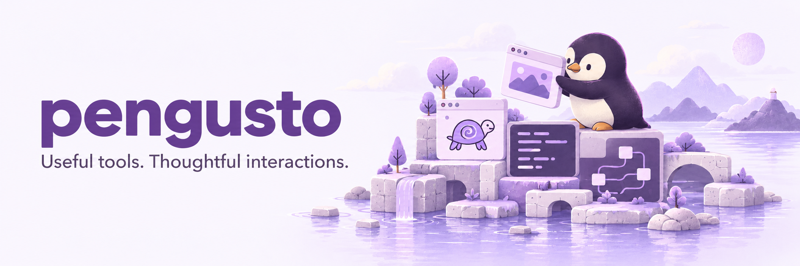
</picture>

<picture>
<source media="(prefers-color-scheme: dark) and (max-width: 600px)" srcset="profile/assets/fusion-hero-dark-mobile.svg">
<source media="(prefers-color-scheme: light) and (max-width: 600px)" srcset="profile/assets/fusion-hero-light-mobile.svg">
<source media="(prefers-color-scheme: dark)" srcset="profile/assets/fusion-hero-dark.svg">
</picture>

<picture><source media="(prefers-color-scheme: dark) and (max-width: 600px)" srcset="profile/assets/extra-franky-circle-dark-mobile.svg"><source media="(prefers-color-scheme: light) and (max-width: 600px)" srcset="profile/assets/extra-franky-circle-light-mobile.svg"><source media="(prefers-color-scheme: dark)" srcset="profile/assets/extra-franky-circle-dark.svg"></picture>

<picture><source media="(prefers-color-scheme: dark) and (max-width: 600px)" srcset="profile/assets/extra-pengusto-terminal-dark-mobile.svg"><source media="(prefers-color-scheme: light) and (max-width: 600px)" srcset="profile/assets/extra-pengusto-terminal-light-mobile.svg"><source media="(prefers-color-scheme: dark)" srcset="profile/assets/extra-pengusto-terminal-dark.svg"></picture>

## Selected work

<a href="https://pengusto.github.io/kaplum-studio/#course/square"><picture><source media="(prefers-color-scheme: dark)" srcset="profile/assets/link-03.svg"></picture></a>

<a href="https://pengusto.github.io/worldfolio/"><picture><source media="(prefers-color-scheme: dark)" srcset="profile/assets/worldfolio-banner-dark-v1.png">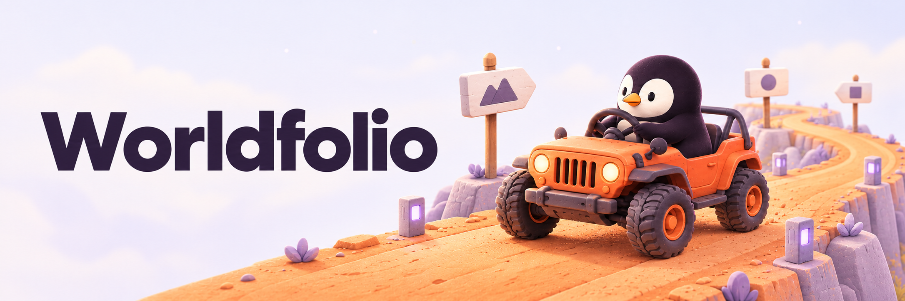</picture></a>

<a href="https://pengusto.github.io/worldfolio/">Drive through Worldfolio →</a> · <a href="https://github.com/pengusto/worldfolio">Source & credits</a>

<a href="https://github.com/pengusto/kaplum-studio"><picture><source media="(prefers-color-scheme: dark)" srcset="profile/assets/project-kaplum-studio-dark.svg"></picture></a>
<a href="https://github.com/pengusto/push-my-tabs"><picture><source media="(prefers-color-scheme: dark)" srcset="profile/assets/project-push-my-tabs-dark.svg"></picture></a>
<a href="https://github.com/pengusto/let-him-grill"><picture><source media="(prefers-color-scheme: dark)" srcset="profile/assets/project-let-him-grill-dark.svg"></picture></a>
<a href="https://github.com/pengusto/penguin-patches"><picture><source media="(prefers-color-scheme: dark)" srcset="profile/assets/project-penguin-patches-dark.svg"></picture></a>

## The city I’m building

<picture>
<source media="(prefers-color-scheme: dark) and (max-width: 600px)" srcset="profile/assets/city-mobile.svg">
<source media="(prefers-color-scheme: light) and (max-width: 600px)" srcset="profile/assets/city-light-mobile.svg">
<source media="(prefers-color-scheme: dark)" srcset="profile/assets/city.svg">
</picture>

## Contribution trail

<picture>
<source media="(prefers-color-scheme: dark) and (max-width: 600px)" srcset="profile/assets/extra-contribution-trail-dark-mobile.svg">
<source media="(prefers-color-scheme: light) and (max-width: 600px)" srcset="profile/assets/extra-contribution-trail-light-mobile.svg">
<source media="(prefers-color-scheme: dark)" srcset="profile/assets/extra-contribution-trail-dark.svg">
</picture>

## Creative toolkit

                       

## 📫 Let’s Connect

   

<a href="https://pengusto.github.io/kaplum-studio/"><picture><source media="(prefers-color-scheme: dark)" srcset="profile/assets/project-site-0-dark.svg"></picture></a> <a href="https://pengusto.github.io/push-my-tabs/"><picture><source media="(prefers-color-scheme: dark)" srcset="profile/assets/project-site-1-dark.svg"></picture></a> <a href="https://pengusto.github.io/let-him-grill/"><picture><source media="(prefers-color-scheme: dark)" srcset="profile/assets/project-site-2-dark.svg"></picture></a> <a href="https://pengusto.github.io/cookbook/"><picture><source media="(prefers-color-scheme: dark)" srcset="profile/assets/project-site-3-dark.svg"></picture></a> <a href="https://pengusto.github.io/worldfolio/"><picture><source media="(prefers-color-scheme: dark)" srcset="profile/assets/project-site-4-dark.svg"></picture></a>

Public GitHub stats

<picture><source media="(prefers-color-scheme: dark)" srcset="assets/readme-stats/stats.svg"></picture>
<picture><source media="(prefers-color-scheme: dark)" srcset="assets/readme-stats/top-langs.svg"></picture>

Generated with [GitHub Readme Stats Action](https://github.com/stats-organization/github-readme-stats-action). [Refresh status ↗](https://github.com/pengusto/pengusto/actions/workflows/refresh-profile.yml)

About the visuals & data

Original GitSkins hero, project cards, wordmark and snake, adapted locally. Penguin banner and actual Kaplum lesson recording retained. Purple city uses actual public GitHub calendar data. Project cards link individually to their repositories. The Creative toolkit uses original colourful Shields badges with logos; project-language percentages describe code composition. Saved SVGs and the City average refresh weekly through GitHub Actions. GitSkins supplies the original hero, project cards, wordmark, orbit portrait, Snake and Social artwork; City rendering is local, and badges come from Shields. All displayed graphics are stored in this repository.

