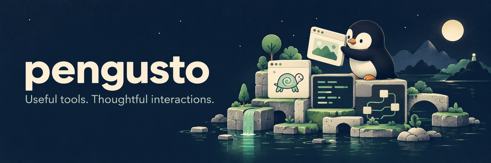

# Hey, I’m Enis 👋

I build tools that make technology easier to use, understand, and work with.
My projects connect **human–technology interaction**, **creative learning**, and **practical AI workflows**.

Find my public repositories under **[pengusto on GitHub](https://github.com/pengusto)**.
Each project README is the starting point for installation, examples, current status and limitations.

## Project websites & demos

| Project | Website | Source |
| :--- | :--- | :--- |
| Push My Tabs | [Chrome & Firefox tab shortcuts](https://pengusto.github.io/push-my-tabs/) | [Repository](https://github.com/pengusto/push-my-tabs) |
| Let Him Grill | [Codex planning skill](https://pengusto.github.io/let-him-grill/) | [Repository](https://github.com/pengusto/let-him-grill) |
| You Got This | [Codex execution skill](https://pengusto.github.io/you-got-this/) | [Repository](https://github.com/pengusto/you-got-this) |
| Cookbook | [Agent workflows for Codex & Claude Code](https://pengusto.github.io/cookbook/) | [Repository](https://github.com/pengusto/cookbook) |
| Kaplum Studio | [Visual JavaScript Turtle studio](https://pengusto.github.io/kaplum-studio/) | [Repository](https://github.com/pengusto/kaplum-studio) |
| Suika 2048 | [Browser puzzle prototype](https://pengusto.github.io/suika-2048-hosted/) | [Repository](https://github.com/pengusto/suika-2048-hosted) |
| Paper Glide | [Unity WebGL game prototype](https://pengusto.github.io/paper-glide-hosted/) | [Repository](https://github.com/pengusto/paper-glide-hosted) |

## Everyday tools

| Project | What it helps you do |
| :--- | :--- |
| **[Push My Tabs](https://github.com/pengusto/push-my-tabs)** | Switch and move browser tabs in the direction they appear. |
| **[Penguin Patches](https://github.com/pengusto/penguin-patches)** | Apply small Android app fixes for everyday usability. Currently: a Calendar preview patch. |

## A little less friction for coding agents

| Project | What it helps you do |
| :--- | :--- |
| **[Let Him Grill](https://github.com/pengusto/let-him-grill)** | Resolve reversible decisions and bring the meaningful choices back to you. |
| **[You Got This](https://github.com/pengusto/you-got-this)** | Take a goal through implementation, verification, and handoff. |
| **[Cookbook](https://github.com/pengusto/cookbook)** | Find a focused workflow for starting, reviewing, resuming, or finishing a project. Experimental beta. |

## Learning & teaching

| Project | What it explores |
| :--- | :--- |
| **[Kaplum Studio](https://github.com/pengusto/kaplum-studio)** | A visual JavaScript Turtle studio: change code and see what happens. Early development. |
| **[Google Classroom MCP](https://github.com/pengusto/google-classroom-mcp)** | Prepare Classroom drafts and teaching resources from a local MCP client. Beta; release checks remain open. |
| **[Full Submission Comments](https://github.com/pengusto/tumo-full-submission-comments)** | A small browser script that reveals truncated comments in the TUMO Activity Manager. |
| **[Lingono](https://github.com/pengusto/lingono-cs50x)** | Japanese vocabulary practice with typed answers and spaced repetition. CS50x final project. |
| **[Vokabelrunde](https://github.com/pengusto/vokabelrunde)** | English-to-German vocabulary practice in a small Python CLI. |

## Games & experiments

Small projects, learning prototypes, and work with existing tools. These are at different stages; each repository documents its scope and limitations.

| Project | What you’ll find |
| :--- | :--- |
| **[Suika 2048](https://github.com/pengusto/suika-2048-hosted)** | A browser-based 2048 portfolio prototype with fruit and number themes. |
| **[Paper Glide](https://github.com/pengusto/paper-glide-hosted)** | An early Unity WebGL flying-game prototype. |
| **[UnityEditorAI](https://github.com/pengusto/UnityEditorAI)** | A thesis prototype exploring natural-language tools in the Unity Editor, developed in cooperation with Capgemini Germany. |
| **[Spark / Hedge Physics 2 Community](https://github.com/pengusto/spark-hedge-physics-2-community)** | An independent community mirror and Unity playground for LakeFeperd’s physics framework. Upstream work credited in the repository. |

*These links showcase work and experiments; they do not imply unrestricted reuse of every asset or upstream component. Check each repository’s notices.*

## What connects the work

Interfaces that explain themselves. Learning through experimentation.
Small improvements to tools I use. AI workflows that keep human judgment in the loop.

[Browse all public repositories](https://github.com/pengusto?tab=repositories) · Explore a project above for setup, status, and examples.
