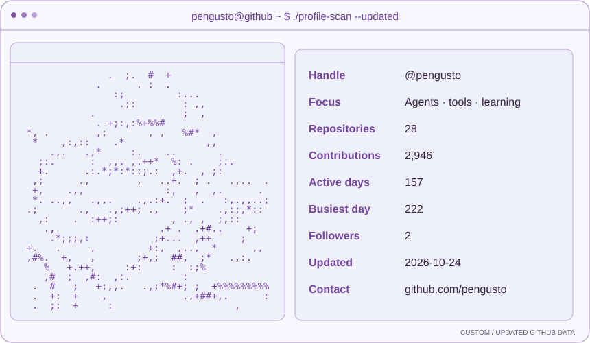
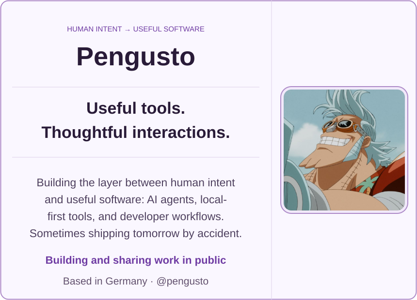
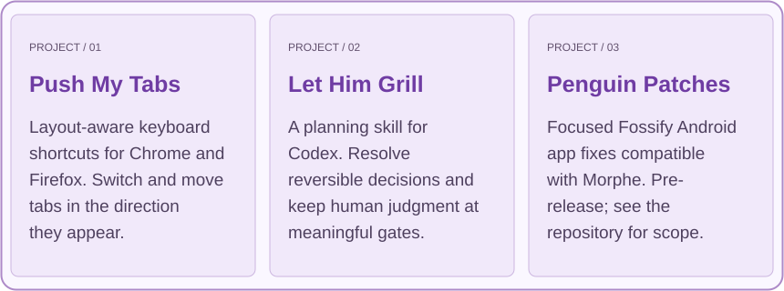

<picture>
<source media="(prefers-color-scheme: dark) and (max-width: 600px)" srcset="assets/profile-banner-purple-mobile.png">
<source media="(prefers-color-scheme: light) and (max-width: 600px)" srcset="assets/profile-banner-purple-light-mobile.png">
<source media="(prefers-color-scheme: dark)" srcset="assets/profile-banner-purple.png">

</picture>

<picture>
<source media="(prefers-color-scheme: dark) and (max-width: 600px)" srcset="assets/scan-mobile.svg">
<source media="(prefers-color-scheme: light) and (max-width: 600px)" srcset="assets/scan-light-mobile.svg">
<source media="(prefers-color-scheme: dark)" srcset="assets/scan.svg">

</picture>

<picture>
<source media="(prefers-color-scheme: dark) and (max-width: 600px)" srcset="assets/intro-mobile.svg">
<source media="(prefers-color-scheme: light) and (max-width: 600px)" srcset="assets/intro-light-mobile.svg">
<source media="(prefers-color-scheme: dark)" srcset="assets/intro.svg">

</picture>

<a href="https://github.com/pengusto"><picture><source media="(prefers-color-scheme: dark)" srcset="assets/link-01.svg"></picture></a>

## The city I’m building

<picture>
<source media="(prefers-color-scheme: dark) and (max-width: 600px)" srcset="assets/city-mobile.svg">
<source media="(prefers-color-scheme: light) and (max-width: 600px)" srcset="assets/city-light-mobile.svg">
<source media="(prefers-color-scheme: dark)" srcset="assets/city.svg">

</picture>

## Selected work

### <a href="https://github.com/pengusto/kaplum-studio"><picture><source media="(prefers-color-scheme: dark)" srcset="assets/link-02.svg"></picture></a>

**Change a value. Follow a step. See what your code can do.**

A visual JavaScript Turtle studio with editable examples, guided experiments, code stepping, and offline export. Early development.

**<a href="https://pengusto.github.io/kaplum-studio/#course/square"><picture><source media="(prefers-color-scheme: dark)" srcset="assets/link-03.svg"></picture></a>** · <a href="https://github.com/pengusto/kaplum-studio"><picture><source media="(prefers-color-scheme: dark)" srcset="assets/link-04.svg"></picture></a>

<picture>
<source media="(prefers-color-scheme: dark) and (max-width: 600px)" srcset="assets/projects-mobile.svg">
<source media="(prefers-color-scheme: light) and (max-width: 600px)" srcset="assets/projects-light-mobile.svg">
<source media="(prefers-color-scheme: dark)" srcset="assets/projects.svg">

</picture>

<a href="https://github.com/pengusto/push-my-tabs"><picture><source media="(prefers-color-scheme: dark)" srcset="assets/link-05.svg"></picture></a> · <a href="https://github.com/pengusto/let-him-grill"><picture><source media="(prefers-color-scheme: dark)" srcset="assets/link-06.svg"></picture></a> · <a href="https://github.com/pengusto/penguin-patches"><picture><source media="(prefers-color-scheme: dark)" srcset="assets/link-07.svg"></picture></a>

## Merged contributions

### <a href="https://github.com/lidge-jun/opencodex/pull/6388"><picture><source media="(prefers-color-scheme: dark)" srcset="assets/link-08.svg"></picture></a>

Fixed the native-login confirmation layout so translated text, long paths and buttons remain readable and contained on narrow screens. Added a rendered CSS-cascade regression for the affected view.

<a href="https://github.com/lidge-jun/opencodex/pull/6388"><picture><source media="(prefers-color-scheme: dark)" srcset="assets/link-09.svg"></picture></a> · <a href="https://github.com/lidge-jun/opencodex"><picture><source media="(prefers-color-scheme: dark)" srcset="assets/link-10.svg"></picture></a>

## More from the workbench

### Agent workflows

- **<a href="https://github.com/pengusto/cookbook"><picture><source media="(prefers-color-scheme: dark)" srcset="assets/link-11.svg"></picture></a>** — Find a focused workflow for starting, reviewing, resuming, or finishing a project. Experimental beta.
- **<a href="https://github.com/pengusto/you-got-this"><picture><source media="(prefers-color-scheme: dark)" srcset="assets/link-12.svg"></picture></a>** — Take a goal through implementation, verification, and handoff.

### Learning & teaching

- **<a href="https://github.com/pengusto/google-classroom-mcp"><picture><source media="(prefers-color-scheme: dark)" srcset="assets/link-13.svg"></picture></a>** — Prepare Classroom drafts and teaching resources from a local MCP client. Beta; release checks remain open.
- **<a href="https://github.com/pengusto/tumo-full-submission-comments"><picture><source media="(prefers-color-scheme: dark)" srcset="assets/link-14.svg"></picture></a>** — A small browser script that reveals truncated comments in the TUMO Activity Manager.
- **<a href="https://github.com/pengusto/lingono-cs50x"><picture><source media="(prefers-color-scheme: dark)" srcset="assets/link-15.svg"></picture></a>** — Japanese vocabulary practice with typed answers and spaced repetition. CS50x final project.
- **<a href="https://github.com/pengusto/vokabelrunde"><picture><source media="(prefers-color-scheme: dark)" srcset="assets/link-16.svg"></picture></a>** — English-to-German vocabulary practice in a small Python CLI.

### Games & experiments

- **<a href="https://github.com/pengusto/suika-2048-hosted"><picture><source media="(prefers-color-scheme: dark)" srcset="assets/link-17.svg"></picture></a>** — A browser-based 2048 portfolio prototype with fruit and number themes.
- **<a href="https://github.com/pengusto/paper-glide-hosted"><picture><source media="(prefers-color-scheme: dark)" srcset="assets/link-18.svg"></picture></a>** — An early Unity WebGL flying-game prototype.
- **<a href="https://github.com/pengusto/UnityEditorAI"><picture><source media="(prefers-color-scheme: dark)" srcset="assets/link-19.svg"></picture></a>** — A thesis prototype exploring natural-language tools in the Unity Editor, developed in cooperation with Capgemini Germany.
- **<a href="https://github.com/pengusto/spark-hedge-physics-2-community"><picture><source media="(prefers-color-scheme: dark)" srcset="assets/link-20.svg"></picture></a>** — An independent community mirror and Unity playground for LakeFeperd’s physics framework. Upstream work credited in the repository.

## Project websites & demos

- <a href="https://pengusto.github.io/push-my-tabs/"><picture><source media="(prefers-color-scheme: dark)" srcset="assets/link-21.svg"></picture></a>
- <a href="https://pengusto.github.io/let-him-grill/"><picture><source media="(prefers-color-scheme: dark)" srcset="assets/link-22.svg"></picture></a>
- <a href="https://pengusto.github.io/you-got-this/"><picture><source media="(prefers-color-scheme: dark)" srcset="assets/link-23.svg"></picture></a>
- <a href="https://pengusto.github.io/cookbook/"><picture><source media="(prefers-color-scheme: dark)" srcset="assets/link-24.svg"></picture></a>
- <a href="https://pengusto.github.io/kaplum-studio/"><picture><source media="(prefers-color-scheme: dark)" srcset="assets/link-25.svg"></picture></a>
- <a href="https://pengusto.github.io/suika-2048-hosted/"><picture><source media="(prefers-color-scheme: dark)" srcset="assets/link-26.svg"></picture></a>
- <a href="https://pengusto.github.io/paper-glide-hosted/"><picture><source media="(prefers-color-scheme: dark)" srcset="assets/link-27.svg"></picture></a>

## What connects the work

Interfaces that explain themselves. Learning through experimentation. Small improvements to tools I use. AI workflows that keep human judgment in the loop.

<a href="https://github.com/pengusto?tab=repositories"><picture><source media="(prefers-color-scheme: dark)" srcset="assets/link-28.svg"></picture></a>

---

System scan, contribution city, profile and project graphics: custom SVG compositions using public GitHub data. The animated purple lines are decorative; the displayed numbers are a recorded snapshot. Kaplum demo: actual application recording. Check each repository for its current scope and asset notices.
